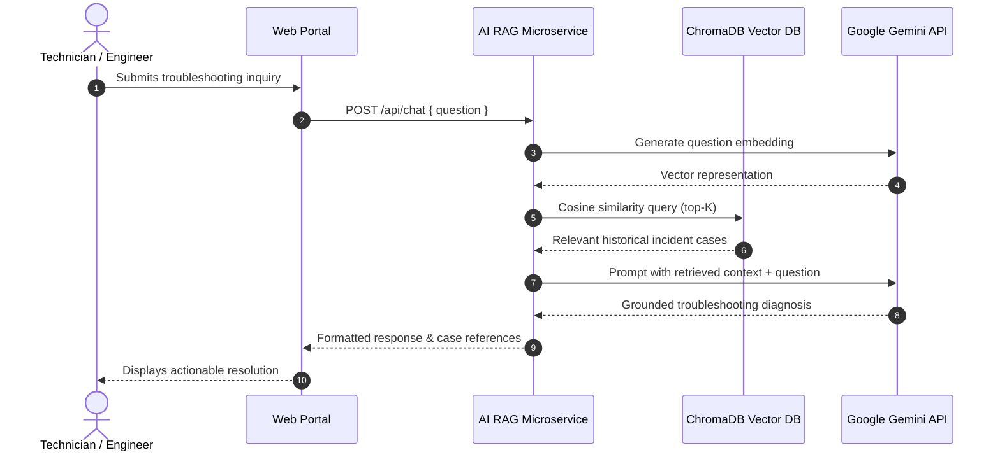

<p align="center">
  
</p>

<h1 align="center">Technical Report Knowledge Management - AI RAG Microservice</h1>

<p align="center">
  <b>Python FastAPI AI microservice powering semantic search and conversational troubleshooting with Retrieval-Augmented Generation (RAG), ChromaDB vector store, and Google Gemini LLM inference.</b>
</p>

<p align="center">
  
  
  
  
  
  
</p>

---

## 📌 Overview

**AI RAG Microservice** is a specialized, asynchronous AI service designed to convert passive technical maintenance documentation, past incident reports, and troubleshooting archives into an active, conversational knowledge base.

It integrates **ChromaDB** as an embedded vector database using **Google Gemini Embeddings (`gemini-embedding-001`)** to index technical incident descriptions and extracted text from uploaded PDF service reports. When technical staff query the system, the microservice executes semantic similarity matching with cosine distance and constructs an augmented prompt for **Google Gemini (`gemini-3.5-flash-lite`)** to generate precise, contextually-grounded troubleshooting recommendations.

---

## 🚀 Key Features

- **Document Ingestion & Chunking:**
  - Automated text parsing from raw incident reports and uploaded PDF maintenance sheets via `pypdf`.
  - Content normalization and token-aware text chunking for vector representation.
- **Dense Vector Embedding Pipeline:**
  - High-dimensional vectorization using Google's `gemini-embedding-001` model.
  - Cosine distance index persistence powered by ChromaDB.
- **Retrieval-Augmented Generation (RAG):**
  - Synthesizes top-K historical incident records with user questions to eliminate AI hallucinations.
  - Produces structured, step-by-step diagnostic and remediation advice.
- **Semantic Troubleshooting Search:**
  - Understands technical context, symptom phrasing, and machine diagnostics beyond exact keyword matches.
  - Computes similarity confidence scores for every retrieved report.
- **Database Synchronization Utilities:**
  - `seed_initial_vectors.py` & `seed_chroma_local.py`: Utilities to vectorize existing SQL Server databases into ChromaDB.
- **Fast, Asynchronous REST API:**
  - Built with FastAPI and Uvicorn for sub-second vector queries and streaming generation.

---

## 🛠️ Technology Stack

| Component | Technologies |
|---|---|
| **Framework & Engine** | FastAPI + Uvicorn (ASGI) |
| **Language** | Python 3.10+ |
| **Vector Database** | ChromaDB (Persistent client, Cosine metric) |
| **LLM Inference** | Google Gemini API (`gemini-3.5-flash-lite` via `google-genai` SDK) |
| **Text Embeddings** | Google Gemini `gemini-embedding-001` |
| **Document Parser** | `pypdf` (PDF extraction) |
| **Data Validation** | Pydantic v2 |
| **Database Sync** | `pyodbc` (SQL Server connection) |

---

## 📂 Project Architecture

```plaintext
AiRagMicroservice/
├── chroma_data/              # Local persistent ChromaDB vector store
├── .env.example              # Environment variables template
├── main.py                   # FastAPI service routes, RAG engine, & Gemini client
├── requirements.txt          # Python dependencies
├── seed_chroma_local.py      # Local script for seeding test vector data
└── seed_initial_vectors.py   # SQL Server to ChromaDB batch vector migration script
```

---

## 🔌 API Endpoints Summary

| Method | Endpoint | Description |
|---|---|---|
| `GET` | `/` | Microservice health check & model status |
| `POST` | `/api/chat` | Conversational RAG query; generates answer using Gemini |
| `POST` | `/api/search` | Semantic similarity vector search; returns top-K documents |
| `POST` | `/api/documents/index` | Ingest technical text report into ChromaDB |
| `POST` | `/api/documents/upload-pdf` | Extract text from uploaded PDF report and index |
| `DELETE`| `/api/documents/{id}` | Remove document vector from ChromaDB |

---

## ⚙️ Getting Started

### Prerequisites

- Python 3.10 or higher
- Valid Google Gemini API Key from [Google AI Studio](https://aistudio.google.com/)

### Installation

1. **Clone the repository:**
   ```bash
   git clone https://github.com/tijartaufikrahman/technical-knowledge-ai-rag.git
   cd technical-knowledge-ai-rag
   ```

2. **Create and activate a virtual environment:**
   ```bash
   # Windows (PowerShell)
   python -m venv venv
   .\venv\Scripts\Activate.ps1

   # Linux / macOS
   python3 -m venv venv
   source venv/bin/activate
   ```

3. **Install dependencies:**
   ```bash
   pip install -r requirements.txt
   ```

4. **Configure Environment Variables:**
   Copy `.env.example` to `.env` and insert your Gemini API Key:
   ```env
   GEMINI_API_KEY=your_actual_gemini_api_key_here
   PORT=22004
   CHROMA_PATH=./chroma_data
   COLLECTION_NAME=knowledge_documents
   EMBEDDING_MODEL=gemini-embedding-001
   LLM_MODEL=gemini-3.5-flash-lite
   ```

5. **Start the Microservice:**
   ```bash
   python main.py
   # Or using uvicorn directly:
   # uvicorn main:app --host 0.0.0.0 --port 22004 --reload
   ```

6. **Interactive OpenAPI Docs:**
   Access the Swagger UI at `http://localhost:22004/docs` to test endpoints interactively.

---

## 🔄 RAG Workflow Diagram



---

## 👤 Author

Developed by **Tijar Taufik Rahman**  
- GitHub: [@tijartaufikrahman](https://github.com/tijartaufikrahman)
- Role: Full Stack Engineer & AI Solutions Engineer
